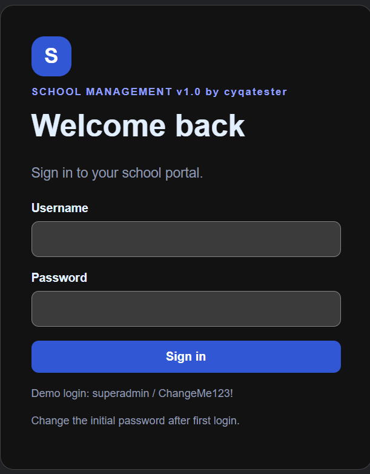
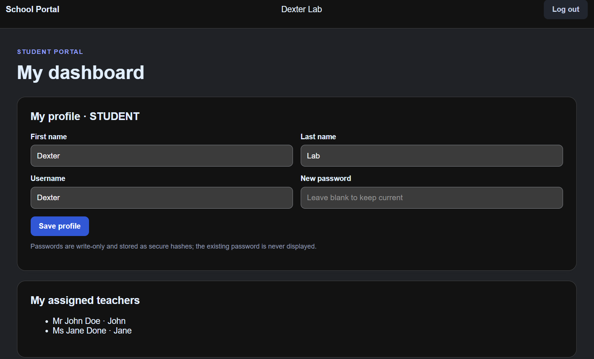
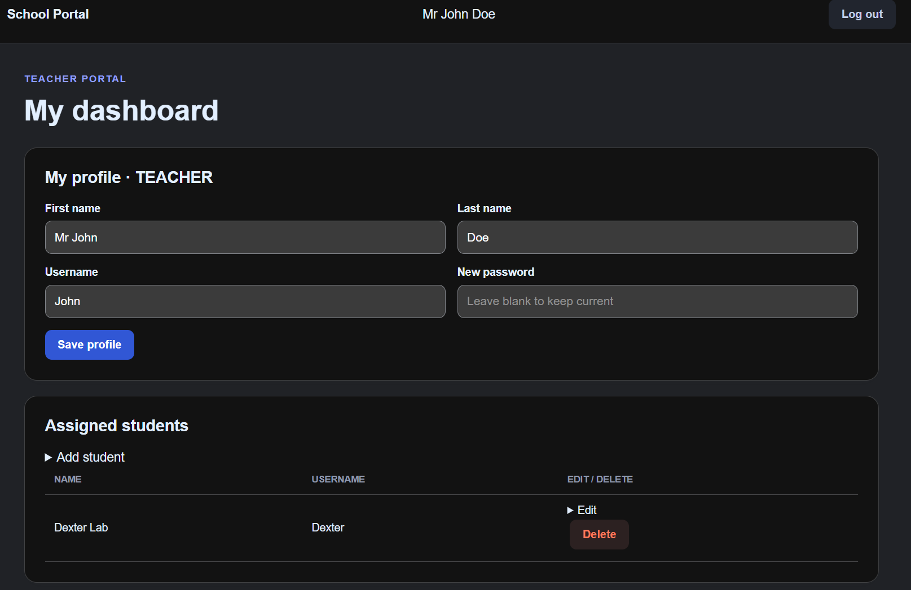
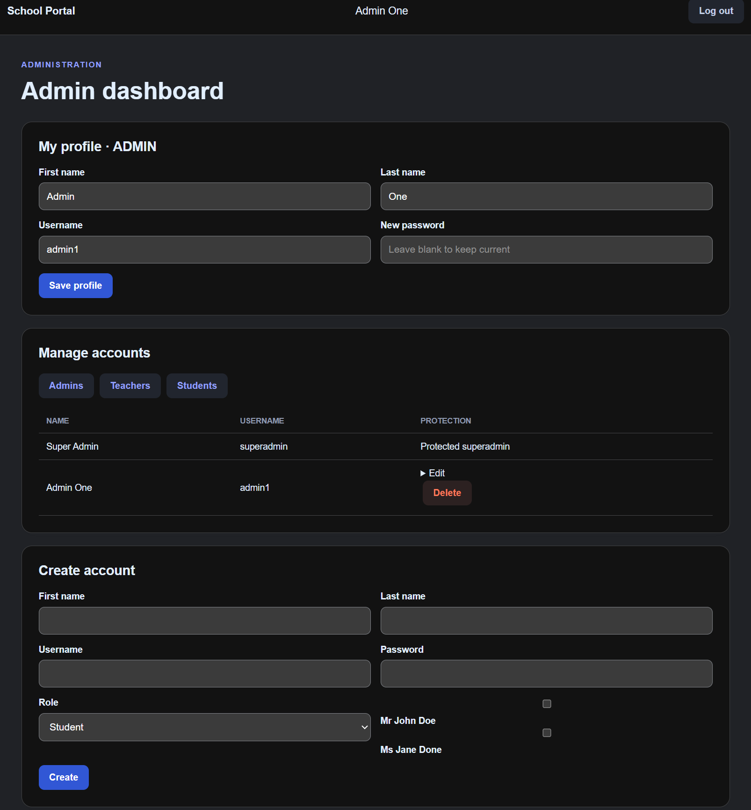

# School Management System

<p>
<picture>
    
</picture> 
</p>

A web-based School Management System built with Java and Spring Boot that simplifies the management of students, teachers, and administrators. The application provides role-based access, student profile management, teacher assignments, and administrative controls through a web interface.

## 1. Technologies

The project uses the following technologies:

- **Java 21** – Main programming language
- **Spring Boot 4** – Backend application framework
- **Spring MVC** – Web application architecture
- **Spring Security** – Authentication and role-based authorization
- **Thymeleaf** – Server-side HTML rendering
- **Maven** – Dependency management and build automation
- **JSON** – File-based data persistence
- **JUnit 5** – Unit testing
- **REST Assured** – API integration testing
- **GitHub Actions** – Continuous Integration (CI)
- **Apache Tomcat 11** – Application deployment

## 2. Features

### Student
- Secure login and authentication.
- View personal profile.
- Edit personal information.
- View assigned teachers.

### Teacher
- Secure login and authentication.
- View assigned students.
- Create student records.
- Update student information.
- Delete assigned student records.

### Administrator
- Secure administrator login.
- Create, view, update, and delete user accounts.
- Manage student and teacher accounts.
- Assign multiple teachers to individual students.
- Protect the original `superadmin` account from deletion.

### General
- Role-based access control.
- JSON-based data storage without requiring a database.
- Secure authentication using Spring Security.
- Automated unit and integration testing.
- Maven-based WAR packaging.
- GitHub Actions CI pipeline.

## 3. The Process

The project was developed using an iterative development approach.

### Step 1: Project Setup
- Created the Spring Boot application using Maven.
- Configured Java and project dependencies.
- Set up the MVC architecture and Thymeleaf templates.

### Step 2: Authentication and Authorization
- Implemented login functionality using Spring Security.
- Created role-based access for students, teachers, and administrators.
- Restricted access to features according to user roles.

### Step 3: Application Features
- Developed student profile management.
- Implemented teacher-to-student assignments.
- Created administrative user management.
- Added support for assigning multiple teachers to students.

### Step 4: Data Persistence
- Implemented JSON-based file storage.
- Configured the application to read and write application data without a relational database.

### Step 5: Testing
- Created JUnit tests for application services.
- Implemented REST Assured integration tests.
- Configured Maven to execute tests during the build process.

### Step 6: Continuous Integration
- Configured GitHub Actions to automatically build and test the application.
- Generated a deployable WAR file after successful verification.
- Uploaded the WAR file as a GitHub Actions artifact.

### Step 7: Deployment
- Prepared the application for deployment on Apache Tomcat 11.
- Configured Jenkins to retrieve and deploy the generated WAR file.
- Planned browser-based verification using Playwright.

## 4. Running the Project

### Prerequisites

Make sure the following are installed:

- Java JDK 21 or compatible version
- Apache Maven 3.10+
- Git
- Apache Tomcat 11 (for WAR deployment)

### Step 1: Clone the Repository

```bash
git clone https://github.com/cyqatester/School-Management-System.git
```

### Step 2: Navigate to the Project

```bash
cd School-Management-System
```

### Step 3: Run Automated Tests

```bash
mvn clean test
```

### Step 4: Build the Application

```bash
mvn clean verify
```

The generated WAR file will be located at:

```text
target/school-management-system.war
```

### Step 5: Run the Application Locally

To run the application using Spring Boot:

```bash
mvn spring-boot:run
```

Open your browser and navigate to:

```text
http://localhost:8080
```

### Step 6: Deploy to Apache Tomcat 11

1. Build the WAR file using Maven.
2. Copy `school-management-system.war` into the Tomcat `webapps` directory.
3. Start Apache Tomcat.
4. Open the application in your browser:

```text
http://localhost:8080/school-management-system/
```

**Note:** The application context path depends on the deployed WAR filename. If you rename the WAR file, the URL will change accordingly.

### Default Administrator Account

If using the initial application data:

| Field | Value |
|---|---|
| Username | `superadmin` |
| Password | `ChangeMe123!` |

**Security reminder:** Change the default administrator password immediately after your first login.

## 5. Preview

Screenshots of the application interface are shown below.

Add your actual application screenshots to a `screenshots` folder in the repository.

### Login Page



### Student Dashboard



### Teacher Dashboard



### Administrator Dashboard




---

## Continuous Integration

GitHub Actions automatically executes the Maven build and test process when changes are pushed to the configured branches or when a pull request is created.

The pipeline performs:

1. Repository checkout.
2. Java environment setup.
3. JUnit and REST Assured tests.
4. Maven WAR generation.
5. Test report upload.
6. WAR artifact upload.

## Project Repository

[School Management System – GitHub](https://github.com/cyqatester/School-Management-System)

---

**Developed as a Java Spring Boot web application project.**
